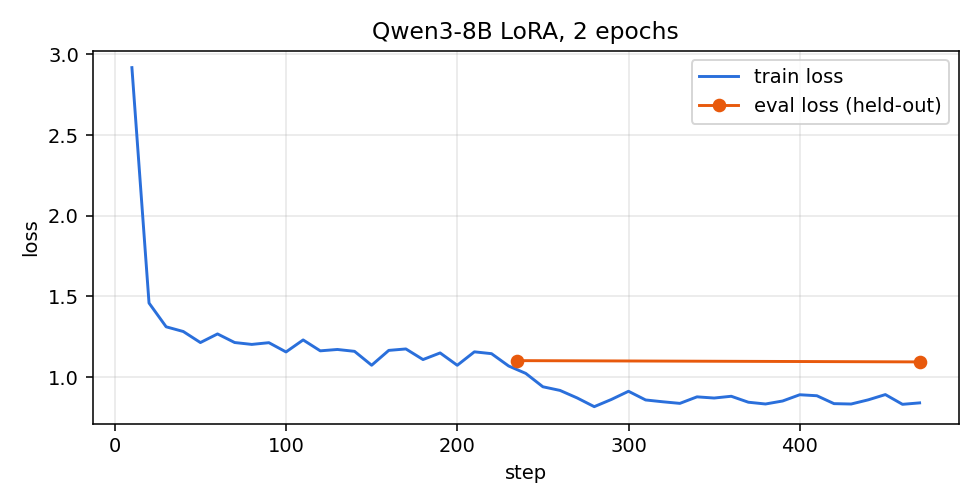

# Qwen3-8B LoRA for NPC dialogue

Fine-tuning an open model to drive the NPC conversations of my Godot RPG. The game sends the NPC's character sheet and the conversation so far; the model has to answer **in character** and return a strict JSON object that the game executes:

```json
{"reply": "...", "action": {"kind": "nenhuma", "args": {}}, "mood_shift": 0}
```

The hard part is not the text. It is knowing **when to act** (sell, give a hint, refuse) and when to just talk. The base model acted almost at random; the fine-tuned one matches the reference action 93% of the time.

> Game text is in Brazilian Portuguese, so the dataset and sample outputs are too.

## Results

Held-out test set: 392 turns from game worlds and characters that the training set never saw (split by world seed). Greedy decoding, bf16.

| Metric | Qwen3-8B base | **Fine-tuned** |
|---|---|---|
| Valid JSON | 99.2% | **100%** |
| Action matches reference | 10.8% | **92.9%** |
| Acted when it should (hits / cases) | 5/21 | **54/74** |
| Acted without the player asking | 90 | **8** |
| Mood shift matches reference | 20% | **90.3%** |
| Words per reply (reference ≈ 21) | 24.9 | **21.8** |

The base model was evaluated on the first 120 test turns only, to save GPU time. Per-example outputs: [`results/eval_base_bf16.json`](results/eval_base_bf16.json).

**Blind test inside the game** (live mode, 30 held-out conversations, 121 lines): the game's rule validator approved **118 of 121 (97.5%)** fine-tuned replies; the other 3 fell back to the templated text. Average 3.7 s per reply on an A10G. Outputs in [`results/blind/`](results/blind/).



Eval loss went from 1.102 (epoch 1) to 1.094 (epoch 2); the adapter is the epoch-2 checkpoint.

## Finding: do not merge and requantize

To run on a consumer GPU the model goes to GGUF Q4 through llama.cpp. There are two ways to ship the adapter, and they are not equivalent (20 test turns, greedy, with the game's JSON schema):

| Deployment | Valid JSON | Action matches | Mood matches |
|---|---|---|---|
| **Official Q4_K_M base + LoRA loaded at runtime (`--lora`)** | **100%** | **90%** | **100%** |
| Merge LoRA into the weights, then requantize to Q4 | 100% | 30% | 80% |

Merging first and quantizing afterwards wipes out most of what the adapter learned, because the small LoRA deltas get rounded away by 4-bit quantization. Keeping the adapter separate in f16 costs 87 MB and keeps the behaviour. Raw outputs: [`results/eval_gguf_*.json`](results/).

## How it was trained

| | |
|---|---|
| Base model | `Qwen/Qwen3-8B`, chat template with `enable_thinking=False` |
| Method | LoRA (PEFT) in bf16, r 16, alpha 32, dropout 0.05, all attention and MLP projections |
| Optimisation | lr 2e-4 cosine, effective batch 16, 2 epochs (470 steps), max length 2048 (no example truncated, p99 = 1,613 tokens) |
| Loss | Assistant turn only (prompt tokens masked with -100) |
| Hardware | AWS g5.2xlarge (1× A10G 24 GB) |
| Time and cost | 222 min, about US$ 6 |

`train.py` also supports 4-bit QLoRA (`QUANT=1`) for 8 GB GPUs; this run did not need it.

## Data

3,755 training and 392 test turns, built from 1,500 game situations sampled from the game's own generator (world state, NPC, relationship level, mood, scene and player lines). One example is one turn: the user message carries the previous turns of the conversation. The prompt is produced by the same function the game uses at runtime, so training and inference see identical text, and every reference reply passed the game's validator (names and numbers only from the sheet, secrets, prices, length).

[`data/sample.jsonl`](data/sample.jsonl) has three examples to show the format. The full dataset lives in the game repository.

## Repository

```
scripts/
  train.py       LoRA / QLoRA training with the HF Trainer
  evaluate.py    batch evaluation on the test set (JSON validity, action, mood, length)
  serve.py       minimal /v1/chat/completions server, compatible with the game's client
  eval_gguf.py   same metrics against a llama.cpp server
  run.sh         environment wrapper used on the GPU box
results/         metrics, per-example outputs, training log
data/sample.jsonl
hf/README.md     model card for the Hugging Face upload
```

## Run it

Adapter on Hugging Face: [NicoDeVargas/qwen3-8b-npc-dialogue-lora](https://huggingface.co/NicoDeVargas/qwen3-8b-npc-dialogue-lora) (PEFT safetensors and an f16 GGUF for llama.cpp).

With llama.cpp (expected 1 to 2 s per reply on an RTX 2060 Super; 30 to 45 s on CPU):

```bash
llama-server -m Qwen3-8B-Q4_K_M.gguf --lora qwen3-8b-npc-dialogue-lora-f16.gguf -c 4096 -ngl 99 --port 8080
```

With transformers:

```bash
pip install torch transformers peft liger-kernel
WORK_DIR=./work python scripts/train.py                 # expects work/train.jsonl and work/test.jsonl
ADAPTER=./work/lora/final TEST_FILE=./work/test.jsonl python scripts/evaluate.py results.json
```

## License

Code under MIT. The adapter follows the Apache 2.0 license of Qwen3.
